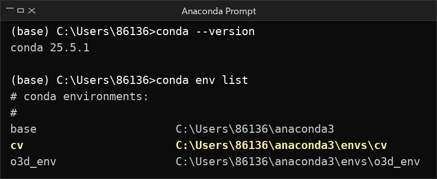
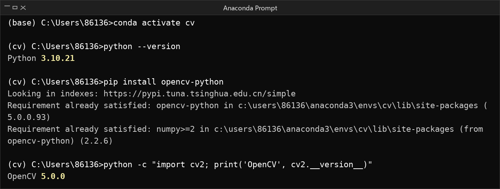
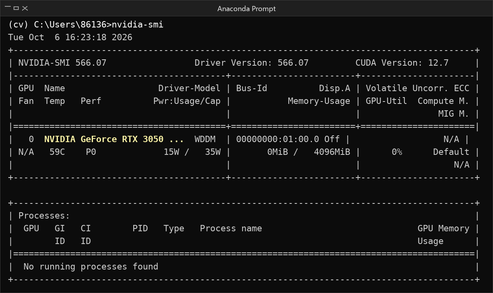
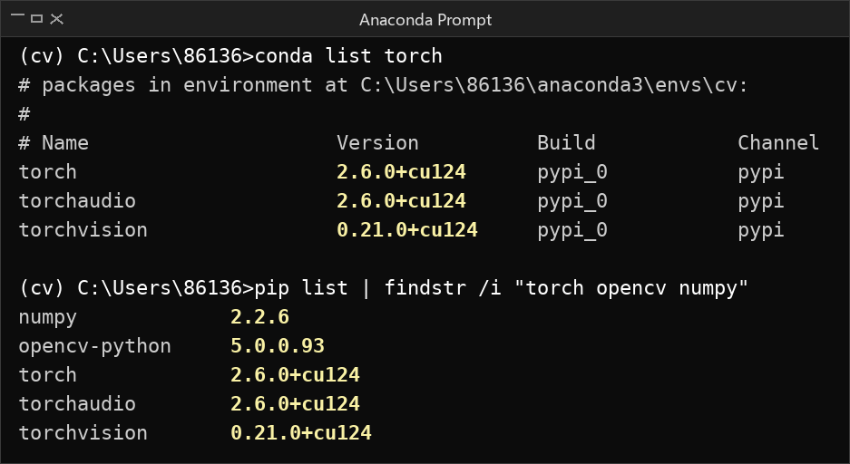
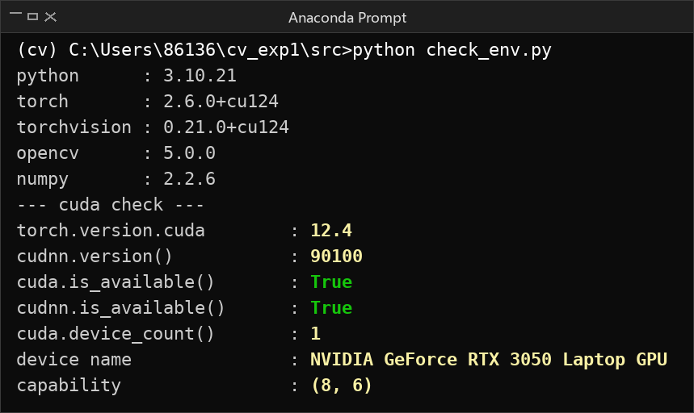
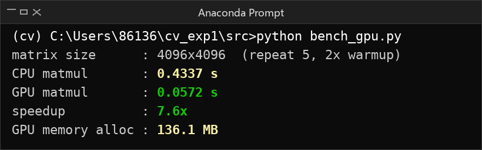

# 计算机视觉 实验一：计算机视觉库的安装

| 姓名 | 学号 | 班级 | 实验日期 |
| --- | --- | --- | --- |
| 李铱璠 | 202410315057 | 人工智能242 |  |

## 一、实验目的

1. 掌握 Anaconda 的安装与基本操作，能够使用 conda 创建、切换和管理虚拟环境。
2. 熟悉 GPU 使用环境的配置流程，理解显卡驱动、CUDA、cuDNN 与深度学习框架之间的版本对应关系。
3. 完成对应版本 PyTorch 的安装，并验证 GPU 加速是否真正可用。
4. 完成 OpenCV 的安装与配置，为后续图像处理与计算机视觉实验准备环境。

## 二、实验内容

### 1. Anaconda 的安装与配置

安装 Anaconda Distribution 2025.06，安装位置为 C:\Users\86136\anaconda3。安装完成后确认 conda 版本，并查看当前已有的虚拟环境。



*图 1  conda 版本与虚拟环境列表*

结果显示 conda 版本为 25.5.1，base 环境位于 C:\Users\86136\anaconda3，除 base 之外还存在 cv 与 o3d_env 两个虚拟环境。

### 2. conda 的基本操作与 OpenCV 的安装

使用 conda activate cv 进入名为 cv 的虚拟环境，确认该环境内的 Python 版本，然后用 pip 安装 OpenCV 并导入验证。



*图 2  conda 激活环境、Python 版本与 OpenCV 安装验证*

cv 环境的 Python 版本为 3.10.21；pip 提示 opencv-python 5.0.0.93 与依赖 numpy 2.2.6 均已满足（Requirement already satisfied）；执行 import cv2 成功，输出 OpenCV 版本 5.0.0。

### 3. GPU 加速环境配置

使用 nvidia-smi 查看显卡型号、驱动版本与驱动支持的 CUDA 版本。



*图 3  nvidia-smi 显卡状态*

显卡为 NVIDIA GeForce RTX 3050 Laptop GPU，显存 4096 MiB；驱动版本 566.07；驱动支持的 CUDA 版本为 12.7；当前 GPU 利用率 0%，无运行中的进程。

### 4. PyTorch 安装

结合驱动支持的 CUDA 版本，从 PyTorch 官网选择对应版本安装（本次安装的是 cu124 版本），安装后查看包版本。



*图 4  PyTorch 及相关包版本查看*

cv 环境中 torch 为 2.6.0+cu124、torchvision 为 0.21.0+cu124、torchaudio 为 2.6.0+cu124，安装渠道标记为 pypi。

### 5. PyTorch GPU 加速环境验证

编写 src/check_env.py，打印关键库版本并检查 torch.cuda.is_available() 与 torch.backends.cudnn.is_available()。



*图 5  GPU 加速环境验证*

验证通过：cuda.is_available() 与 cudnn.is_available() 均返回 True，torch.version.cuda 为 12.4，cuDNN 版本为 90100，检测到 1 块 GPU，计算能力 (8, 6)。

为了确认 GPU 加速不只是“能识别到显卡”而是确实更快，另编写 src/bench_gpu.py，用同一规模的矩阵乘法对比 CPU 与 GPU 的耗时。



*图 6  4096×4096 矩阵乘 CPU 与 GPU 耗时对比*

## 三、实验结果分析

### 1. 环境版本与兼容性

| 组件 | 版本 | 说明 |
| --- | --- | --- |
| Anaconda | Distribution 2025.06 | 安装于 C:\Users\86136\anaconda3 |
| conda | 25.5.1 | 默认求解器 libmamba |
| 虚拟环境 | cv | Python 3.10.21 |
| 显卡驱动 | 566.07 | 驱动侧支持 CUDA 12.7 |
| PyTorch | 2.6.0+cu124 | pip 安装，渠道 pypi |
| torchvision | 0.21.0+cu124 | pip 安装 |
| 编译用 CUDA | 12.4 | torch.version.cuda |
| cuDNN | 9.1.0（90100） | torch.backends.cudnn.version() |
| OpenCV | 5.0.0.93 | pip 安装 |
| NumPy | 2.2.6 | OpenCV 依赖 numpy>=2 |

版本兼容性是本实验最关键的一环。驱动 566.07 支持的最高 CUDA 版本为 12.7，而 PyTorch 使用 CUDA 12.4 运行时，属于向下兼容，因此可以正常工作。显卡计算能力为 (8, 6)（sm_86），落在 cu124 版 PyTorch 支持的架构范围内，不存在“架构不被支持”的问题。这解释了为什么 cuda.is_available() 直接返回 True，而无需额外降级或升级任何组件。

### 2. 关于系统级 CUDA Toolkit

本次实验并未单独安装 NVIDIA CUDA Toolkit：检查发现 nvcc 命令不存在、环境变量 CUDA_PATH 为空、C:\Program Files\NVIDIA GPU Computing Toolkit\CUDA 目录也不存在。但 PyTorch 的 GPU 加速依然完全可用，原因是 pip 安装的 PyTorch 自带 CUDA 运行时与 cuDNN 库（torch.version.cuda = 12.4，cuDNN 90100），只依赖显卡驱动，不依赖系统级 Toolkit。conda 报告的虚拟包 __cuda=12.7=0 也印证了这一点：conda 识别到的是驱动提供的 CUDA 能力，而不是本地安装的 Toolkit。

结论：如果只是运行 PyTorch 做训练或推理，不安装 CUDA Toolkit 完全可行；只有需要自行编译 CUDA 扩展（例如自定义算子、带 CUDA 加速的 OpenCV）时，才必须安装 Toolkit 以获得 nvcc 编译器。

### 3. GPU 加速的实际效果

| 后端 | 单次耗时 | 相对加速 |
| --- | --- | --- |
| CPU | 0.4337 s | 1.0× |
| GPU | 0.0572 s | 7.6× |

测试方法：矩阵规模 4096×4096 单精度，每个后端先空跑 2 次预热，再取 5 次运行的平均值；GPU 侧在计时前后各调用一次 torch.cuda.synchronize()。

关于预热：第一次测试时 GPU 反而比 CPU 慢（0.224 s 对 0.075 s），原因是 CUDA 上下文的首次初始化（创建 context、加载内核模块）耗时被计入了计时区间。加入预热后 GPU 稳定在 0.0572 s，加速比达到 7.6 倍。这说明测试 GPU 性能必须先预热，否则结果没有参考价值。

关于同步：CUDA 内核调用默认是异步的，如果不调用 torch.cuda.synchronize()，计时得到的只是把任务提交进队列的时间，而不是真实计算时间，会严重低估 GPU 耗时。加上同步后测得的 7.6 倍加速才是可信的。

### 4. 两个容易踩的坑

坑一：conda list pytorch 查不到任何结果。参考文档用这条命令确认 PyTorch 是否安装成功，但本次执行只输出了表头。原因有两个：一是 PyTorch 的包名是 torch 而非 pytorch，conda 把参数当作正则去匹配包名，pytorch 无法匹配 torch；二是本次 PyTorch 由 pip 安装，渠道标记为 pypi 而不是 conda 渠道。改用 conda list torch 或 pip list 即可正常查看。

坑二：pip 安装的 OpenCV 是 CPU 版本。执行 cv2.cuda.getCudaEnabledDeviceCount() 返回 0，说明 PyPI 上的 opencv-python 轮子并未编译 CUDA 模块，无法使用 GPU 加速。若后续实验需要 OpenCV 的 CUDA 加速（如 GPU 版图像滤波、光流计算），需要自行从源码编译带 CUDA 支持的 OpenCV，或改用预编译的 CUDA 版本。本次实验的图像处理规模较小，CPU 版本已经足够。

### 5. 镜像源

pip 使用清华镜像 https://pypi.tuna.tsinghua.edu.cn/simple ，conda 配置了 https://mirrors.tuna.tsinghua.edu.cn/anaconda/pkgs/main 等渠道。从安装日志可以看到下载均走镜像源，速度明显快于官方源，这在后续安装体积较大的深度学习包时会体现得更明显。

## 四、实验小结

1. 完成了 Anaconda 的安装与配置，掌握了 conda create / conda activate / conda env list / conda list 等虚拟环境管理命令，理解了“一个环境一套依赖”的隔离思路，可以避免不同项目的包版本互相冲突。
2. 完成了 OpenCV 的安装与验证，掌握了用 pip 安装第三方库，以及通过 import 并打印版本号来确认安装是否成功的方法。
3. 完成了 GPU 加速环境的配置与 PyTorch 安装，理清了显卡驱动 → CUDA 运行时 → cuDNN → 深度学习框架这条依赖链，明确了“驱动版本决定支持的 CUDA 上限、框架自带运行时”这一关键认识。
4. 通过 torch.cuda.is_available() 与 torch.backends.cudnn.is_available() 双重验证确认 GPU 加速环境可用，并用 CPU/GPU 对比测试量化出 7.6 倍的加速比，证明加速确实生效，而不只是环境能识别到显卡。
5. 认识到两个实际问题：查询 conda 包时要留意真实包名与安装渠道；pip 版 OpenCV 不含 CUDA 模块。这两点经验对后续排查环境问题很有帮助。
6. 本次实验是后续 CV 实验的基础。环境已经就绪，接下来可以在此基础上开展图像读取与处理、卷积神经网络训练等实验。

## 附：仓库结构

```
cv_exp1/
├── README.md                  本实验报告
├── images/                    实验截图
│   ├── 01_anaconda.png
│   ├── 02_opencv.png
│   ├── 03_nvidia_smi.png
│   ├── 04_pytorch.png
│   ├── 05_gpu_verify.png
│   └── 06_benchmark.png
└── src/                       验证脚本
    ├── check_env.py           打印版本并检查 CUDA / cuDNN 可用性
    └── bench_gpu.py           CPU 与 GPU 矩阵乘耗时对比
```
